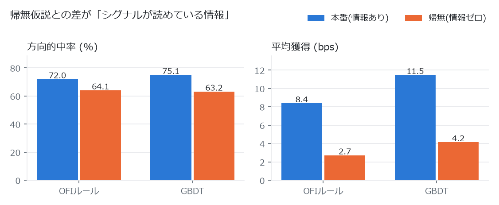

# stock-engine — 日本株の板情報エンジン

`hft-engine/`（暗号資産の板エンジン）の株式版です。**既存のファイルは一切変更していません。**

証券口座がなくても今日から全機能が動きます。口座を取得したら、アダプタの起動オプションを1つ外すだけで実データに切り替わります。

---

<picture>
  <source media="(prefers-color-scheme: dark)" srcset="docs/null-test-dark.png">
  
</picture>

**情報ゼロのフィードでも的中率は 60% を超えます**(板の構造だけで生じる見かけのエッジ)。
このプロジェクトでは、同じ条件で「オーダーフローに情報がない」帰無フィードを必ず同時に測り、**その差**だけをシグナルの実力として扱います。

| | 本番の的中率 | 帰無の的中率 | 獲得の差 |
|---|---|---|---|
| OFI ルール(42日分, seed 42) | 72.0% | 64.1% | +5.66 bps |
| GBDT(20日分, 学習と別seed 777) | 75.1% | 63.2% | +7.33 bps |

板エンジン自体の性能は `bench.exe`(500万イベント)で p50 58 ns / p99 107 ns、スループット 7.56 M events/sec。
すべて合成フィード上の結果で、実市場の利益を示すものではありません。

## 目次

1. [まず用語を10分で](#1-まず用語を10分で)
2. [5分で動かす](#2-5分で動かす)
3. [各コマンドが何をしているか](#3-各コマンドが何をしているか)
4. [結果の読み方 — ここが一番大事](#4-結果の読み方--ここが一番大事)
5. [ファイル構成](#5-ファイル構成)
6. [日本株ならではの3つの事情](#6-日本株ならではの3つの事情)
7. [口座を取得したあと](#7-口座を取得したあと)
8. [困ったとき](#8-困ったとき)

---

## 1. まず用語を10分で

このプロジェクトを読むのに必要な言葉だけ、順番に説明します。

### 板（いた）と気配（けはい）

株の売買は「オークション」です。買いたい人は「1株2,500円までなら買う」、売りたい人は「2,501円以上なら売る」と注文を出します。この注文を価格ごとに集めた一覧表が**板**（英語では order book）で、板に並んでいる注文を**気配**と呼びます。

```
        売り気配（ask / 売りたい人）
   2,503円   1,200株
   2,502円     800株
   2,501円     300株   ← 最も安い売り = best ask
   ------------------  スプレッド = 1円
   2,500円     500株   ← 最も高い買い = best bid
   2,499円     900株
   2,498円   1,500株
        買い気配（bid / 買いたい人）
```

- **best bid / best ask**: 一番高い買い注文 / 一番安い売り注文。「今すぐ売れる値段 / 今すぐ買える値段」です。
- **スプレッド**: best ask − best bid。上の例では1円。**今すぐ買ってすぐ売ると、この1円を必ず損します。** これが取引の最大のコストです。
- **mid（ミッド）**: (best bid + best ask) ÷ 2。上の例では2,500.5円。「今の理論価格」として使います。

### 呼値（よびね）

株価は1円刻みとは限りません。東証は価格帯ごとに刻み幅を決めています。これが**呼値**です。

| 株価 | 呼値（通常銘柄） | 呼値（TOPIX100銘柄） |
|---|---|---|
| 〜3,000円 | 1円 | 0.5円 |
| 〜5,000円 | 5円 | 1円 |
| 〜30,000円 | 10円 | 5〜10円 |

TOPIX100（時価総額上位100銘柄）は取引が活発なので、より細かい刻みが許されています。**呼値はコストの下限です。** 4,000円の通常銘柄なら呼値5円 = 12.5 bps を、どんなに賢いシグナルでも往復で必ず払います。

### 値幅制限（ストップ高・ストップ安）

株は1日に動ける幅が決まっています。前日終値（**基準値段**）2,500円なら当日は ±500円、つまり2,000〜3,000円の間でしか取引できません。上限に達すると「ストップ高」、下限なら「ストップ安」です。

### 板寄せ（いたよせ）とザラ場（ざらば）

東証の1日は2つのモードを行き来します。

- **ザラ場**（連続約定）: 注文が入るたびに、条件が合えば即座に約定します。9:00〜11:30と12:30〜15:25がこれ。
- **板寄せ**（一括約定）: 注文を溜めてから、**約定株数が最大になる1つの価格**を選んで全部まとめて約定させます。9:00の寄り付き、11:30の前引け、12:30の後場寄り、15:30の引けがこれ。

板寄せの前は板がクロス（買い気配が売り気配より高い状態）していて当然です。ザラ場ではクロスは絶対に起きません。**このプロジェクトでは板寄せ中のデータを一切シグナルに使いません**（価格形成の仕組みが違うので混ぜると数字が壊れます）。

### 東証の1日

```
08:00 ────────── 注文受付開始（約定しない）
09:00 ★板寄せ    寄り付き（始値が決まる）
      │
      │ 前場ザラ場
      │
11:30 ★板寄せ    前引け
      │ 昼休み（12:05から注文受付）
12:30 ★板寄せ    後場寄り
      │
      │ 後場ザラ場
      │
15:25 ────────── クロージング・オークション（注文受付のみ）
15:30 ★板寄せ    引け（終値が決まる）
```

出来高とボラティリティ（値動きの激しさ）は**日中U字**を描きます。寄り付きと引けで跳ね、昼前後で最も静かになります。だから「時間帯」は株の予測において意味のある情報です。

### OFI（オーダーフロー不均衡）

このプロジェクトの中心にある指標です。英語では Order Flow Imbalance。

考え方はシンプルです。「買い注文が積み上がったり、買い気配が上がったりしたら **+**。売り側で同じことが起きたら **−**」を1イベントごとに足していきます。

```
買い気配が2,500円→2,501円に上がった     → 大きく +
買い気配2,500円の株数が500→800株に増えた → 少し +
売り気配が2,501円→2,500円に下がった     → 大きく −
```

これを直近64イベントぶん合計し、**z-score**（平均からの標準偏差いくつぶんズレているか）に変換します。|z| が 2.5 を超えたら「異常に偏っている」と判断してシグナルを出します。

OFIは学術的にも「短期の価格変動を最もよく説明する板指標」として知られています（Cont-Kukanov-Stoikov 2014）。

### マイクロプライス

mid を株数で重み付けした価格です。買い側が厚ければ ask 寄りになります。「次に価格が動く方向」の推定値として使います。

### bps（ベーシスポイント）

万分率です。1 bps = 0.01%。2,500円の株で1円は 1/2500 × 10,000 = **4 bps**。

**なぜ円でなく bps を使うか**: 呼値が価格帯で変わるので、「1ティック取れた」では銘柄間で比較できません。bps に直せば2,500円の株と40,000円の株を並べて比べられます。

---

## 2. 5分で動かす

### 必要なもの

- **MinGW-w64 の g++ 13以降**（確認済み: 15.2.0）。C++側は外部ライブラリ不要。
- **Python**。`lightgbm` `numpy` `pandas` `yfinance` `requests` `websocket-client` を使います（すべて導入済み）。
- 証券口座は**不要**です。

### 手順

```bat
cd stock-engine

:: (1) ビルド
build.bat

:: (2) エンジンが正しいことを確認（呼値・板・速度）
bench.exe

:: (3) OFIシグナルのバックテスト
backtest.exe

:: (4) 機械学習（GBDT）のパイプライン一式 — 5〜10分かかります
build_ml.bat
backtest_ml.exe

:: (5) どの銘柄に繋ぐべきか（無料の実データを使います）
..\Scripts\python.exe adapters\scan_stocks.py
```

### ライブ収録を試す（口座不要）

端末を**2つ**開いてください。

```bat
:: 端末1 — 受信エンジン
cd stock-engine
live.exe

:: 端末2 — 合成板を流すアダプタ（1立会日を120倍速で再生）
cd stock-engine
..\Scripts\python.exe adapters\kabu_adapter.py --mock --speed 120
```

端末1にこう出ます。

```
[16:52:23] RESET 基準値段 2500.0円 -> 窓 [2000.0, 3000.0]円 1001本 (呼値 1.00円)
[16:52:23] SESSION PreOpen
[16:52:27] SESSION MorningAuction
[16:52:27] SESSION Morning
[16:55:30] SIGNAL SELL z=-2.63 mid=2497.50円 spread=1.00円 厚み比 +0.16
[stat] 433 msg/s | Morning | bid 2497.00 x 400 | ask 2498.00 x 100 | spread 1.00 | z -0.58 | 出来高 178500株 | signals 15
```

Ctrl+C で止めると `captures/capture_YYYYMMDD_HHMMSS.bin` に収録されています。それを検証・採点します。

```bat
replay.exe captures\capture_20260730_165624.bin
```

---

## 3. 各コマンドが何をしているか

### `bench.exe` — 「速いだけで間違っている」を防ぐ安全網

3段階で確かめます。

1. **呼値テーブルの自己検証**: 円 → ティック番号 → 円 の往復が壊れていないか。値幅制限から計算した価格窓が正しいか。
2. **板の整合性検証**: 高速なフラット配列の板と、素直な `std::map` で書いた参照実装が、**全イベントで完全に一致するか**。あわせてザラ場でクロスが起きていないかも見ます。
3. **性能計測**: rdtsc（CPUのサイクルカウンタ）で1イベントあたりの処理時間を測ります。

実測値:

```
[2/3] 板の整合性検証 (フラット配列 vs std::map 参照実装)
      板イベント 748208 件を照合 (reset 3 / 約定 242670 / セッション 57)
      OK — 全イベントで best bid/ask が一致
      ザラ場 661152 件のクロス検査: OK — クロスなし

[3/3] 性能計測 (rdtsc)
      スループット : 7.40 M events/sec
      レイテンシ   : p50 54.3 ns / p99 107.9 ns / p99.9 317.0 ns
```

**速度最適化はここが緑のときだけ意味があります。** 最適化を入れたら必ず `bench.exe` を通してください。

### `backtest.exe` — OFIシグナルのバックテスト

合成フィードを流して、|OFI z-score| > 2.5 でシグナルを出し、500イベント先の mid 変動で採点します。**必ず2回走ります**（理由は次の章）。

### `build_ml.bat` → `backtest_ml.exe` — 機械学習

1. `dump_features.exe` が特徴量16種 + 正解ラベルを CSV に出す（seed 42〜45 + 帰無データ）
2. `train_export.py` が LightGBM を学習し、**全決定木を if-else の C++ コードに変換**して `model.hpp` を生成する
3. `backtest_ml.exe --verify` で **Python の予測値と C++ の予測値が完全一致するか**を確認する
4. `backtest_ml.exe` が未学習の seed 777 でアウトオブサンプル評価する

手順3が重要です。学習と推論で数値がズレていると「Pythonでは効いたのに実運用で効かない」を見逃します。実測では最大絶対差 0（完全一致）でした。

### `live.exe` / `replay.exe` — 実データの受信と検証

`live.exe` が TCP 9501 で待ち受け、アダプタから送られてくるバイナリを板に反映しながら**全フレームをそのまま `captures/` に収録**します。`replay.exe` はその収録を再生して、参照実装との照合と実時間ホライズンでの採点をします。

`replay.exe` のホライズンは**イベント数ではなく秒**です。株はイベント密度が時間帯で10倍以上変わるので、イベント数で測ると寄り付きと昼でまったく違う時間長を測ってしまいます。

### `adapters/scan_stocks.py` — どの銘柄に繋ぐべきか

無料の1分足（yfinance、登録不要）で主要15銘柄を評価してランキングします。

```
code   銘柄            株価     呼値  vol/sp  必要hit (手数料0)  実測hit    誤差     余裕  n_eff  判定
6861   キーエンス     81380.0  10.00    72.6   51.8%    50.7%   52.9%  5.6pt   +1.1pt    79  ノイズ内
9984   ソフトバンクG   5277.0   1.00    54.1   51.9%    50.9%   57.5%  5.9pt   +5.6pt    71  ノイズ内
8035   東京エレクトロン 55470.0 10.00    51.4   52.1%    51.0%   49.7%  5.7pt   -2.3pt    77  コスト負け
...
7203   トヨタ自動車    3065.0   1.00    10.0   58.1%    55.0%   51.8%  5.7pt   -6.3pt    76  コスト負け
9432   日本電信電話     152.4   0.10     2.9   72.9%    67.5%   56.3%  6.5pt  -16.6pt    59  対象外
```

**この表の一番大事な列は `vol/sp` と `必要hit` です。**

`必要hit` は損益分岐の的中率で、次の式を解いた値です。

```
(2 * hit - 1) * vol_bps  =  spread_bps + 2 * fee_bps
        ↓
hit = 0.5 + (spread_bps + 2 * fee_bps) / (2 * vol_bps)
```

つまり**決めているのは `vol_bps / spread_bps`（値幅とコストの比）であって、シグナルの賢さではありません。** NTT（9432）は必要的中率72.9%で、呼値が株価に対して大きすぎるため**どんなモデルでも原理的に届きません**（`対象外`）。一方キーエンスやSBGは50.7〜51.9%で足ります。銘柄選択がモデル改善より先に来る理由です。

`手数料0` の列も見てください。現物ゼロ革命の証券会社を使うと必要的中率が平均2.8pt下がります。モデルを改善するより効くことがあります。

#### `誤差` と `判定` — ここを見ないと必ず騙されます

`n_eff` は**実質の独立サンプル数**です。1,590本の1分足があっても、窓10本・ホライズン5本でラベルが重なり、さらに`|signal|`上位1/4でしか発火しないので、独立サンプルは**約76件**しかありません。的中率の標準誤差は **±5.7pt** です。

そこで `判定` は「余裕（実測hit − 必要hit）が誤差の2倍を超えたか」で出しています。超えなければ `ノイズ内` です。

さらに、誤差が大きいときは自動で警告が出ます。

```
[警告] 全銘柄の真の的中率が50%(=情報ゼロ)だと仮定して15銘柄スキャンすると:
         最高の銘柄の的中率  シミュレーション 59.2%  /  実測 59.5%
         最高-最低の幅       シミュレーション 19.7pt /  実測 13.9pt
```

**情報がまったく無くても、15銘柄も見れば最高値は59%台になります。** 実測の最高値（デンソー59.5%）はシミュレーション（59.2%）とほぼ同じで、順位に意味がないことを示しています。「デンソーが優秀」と判断すると確実に騙されます。

独立サンプルを増やすには `--days` を増やすか銘柄数を増やしてください。真の4ポイントのエッジを検出するには**独立サンプル1,225件**が必要です。

#### 並び順

既定は `vol_sp`（構造的な勝ちやすさ）です。モデルを変えても動かない量なので、銘柄選択はここで決まります。

```bat
..\Scripts\python.exe adapters\scan_stocks.py --sort margin   :: 損益分岐からの余裕
..\Scripts\python.exe adapters\scan_stocks.py --sort edge     :: 期待エッジ
..\Scripts\python.exe adapters\scan_stocks.py --fee-bps 0     :: 手数料ゼロで再評価
```

#### 無料データの限界

板が無いので、OFIの代わりに**符号付き出来高**（値上がりした足の出来高は買い主導と分類、ティックルール）を使います。この代用指標は過去のリターンと機械的に相関するため、シャッフル検定（`ic_shuf` / `hit_shuf`、CSVに出力）を必ず並べて出しています。`--source kabu` にすると本物の best-level OFI に切り替わります。

なお `spread_bps` は呼値 = **理論下限**です。実際のスプレッドは必ずこれ以上なので、`必要hit` は**最も甘い見積もり**であり、実際にはもっと高い的中率が要ります。

---

## 4. 結果の読み方 — ここが一番大事

### 「的中率70%」は単体では何の意味もありません

このプロジェクトのバックテストは**必ず2回走ります**。

```
[本番] オーダーフローに情報あり
  方向的中率     : 70.4%
  平均獲得       : +9.301 bps/シグナル

[帰無] オーダーフローに情報なし (drift=0, coupling=0)
  方向的中率     : 62.4%
  平均獲得       : +3.817 bps/シグナル

--- 判定 ---
的中率の差 : +8.0 pt  (本番 70.4% - 帰無 62.4%)
獲得の差   : +5.484 bps (本番 +9.301 - 帰無 +3.817)
```

**帰無**は「オーダーフローに情報を一切入れていないフィード」です。売り買いの発注は完全なコイン投げ、価格はただのランダムウォーク。ここで的中率が50%になるべき、と思うでしょう。**なりません。62.4%出ます。**

理由は、合成フィードには「板が理論価格に追いつくまでの遅れ」が必ず残るからです。OFIはこの遅れを読めてしまうので、情報がゼロでも当たります。

開発中、この現象を放置していた段階では**情報ゼロのフィードで的中率88%**が出ていました。無関係な位置のz-scoreを使ったシャッフル検定では49.3%だったので、計測ミスではなくフィードの構造そのものが原因だと確定しました。板の裁定（理論価格から乖離した気配は即座に食われる）を入れて64%まで下げ、残りは帰無として毎回測る方針にしました。

**つまり、報告すべき数字は「70.4%」ではなく「+8.0 pt」です。**

これは合成フィードに限った話ではありません。実データを使うときも必ず何らかの帰無（ランダムな方向、ラベルのシャッフル）と比べてください。`scan_stocks.py` が `ic_shuf` / `hit_shuf` を出しているのも、`replay.exe` が「この的中率だけでは判断できません」と表示するのも、同じ理由です。

### 実測されている結果

同一条件（200,000イベント/日 × 10日、seed 777 = GBDTの学習に使っていないデータ）で測ったものです。

| 指標 | OFI単体 | GBDT（16特徴量） |
|---|---|---|
| 的中率（本番） | 70.9% | 75.6% |
| 的中率（帰無） | 64.2% | 64.8% |
| **的中率の差** | **+6.7 pt** | **+10.8 pt** |
| 平均獲得（本番） | +5.18 bps | +11.59 bps |
| 平均獲得（帰無） | +2.32 bps | +4.43 bps |
| **獲得の差** | **+2.86 bps** | **+7.16 bps** |

GBDTはOFI単体の**2.5倍のエッジ**を取っています。学習時の検証データでも、発火時の方向的中率が帰無データより13ポイント上でした。

再現方法:

```bat
backtest.exe    200000 10 777
backtest_ml.exe 200000 10 777
```

株用に追加した特徴量が効いていることも重要度から確認できます（`build_ml.bat` の出力）。

```
ofi_z64      1743791   ← OFIのz-score（中期）
ofi_z16      1312177   ← OFIのz-score（短期）
depth_imb     781261   ← ★株用に追加: 上位5段の厚み不均衡
ofi_z256      762128   ← OFIのz-score（長期）
u_shape       399882   ← ★株用に追加: 日中U字の強度
ret128        294431
tod           127735   ← ★株用に追加: 立会の進捗（時間帯）
...
micro_prem_rel     0   ← 一度も使われていない（削除候補）
is_pm              0   ← 一度も使われていない（削除候補）
```

3位に `depth_imb`、5位に `u_shape`、7位に `tod` が入っています。「best 1段だけでなく多段の厚みを見る」「時間帯を入れる」という株固有の判断が実際に予測に貢献しています。

一方 `micro_prem_rel` と `is_pm` は一度も使われていません。`micro_prem_rel` は `hft-engine` 側でも同じ結果でした。`is_pm`（後場フラグ）は `tod` に情報が含まれているためです。どちらも削除して15特徴量にしても成績は変わりません。

### そして、実際の日本株では儲かりません

`scan_stocks.py` の実測結果を見てください。`edge_bps` はほぼ全銘柄で負です。しかもそこで使っているスプレッドは呼値 = 理論下限なので、**実際にはもっと負けます**。

日本株の日中の値動きは呼値に対して小さく、往復コスト（スプレッド + 手数料）を短期の板シグナルで超えるのは非常に困難です。これは能力の問題ではなく、市場の構造です。

このプロジェクトの価値は、**その構造を自分で測れるようになること**にあります。

---

## 5. ファイル構成

| ファイル | 内容 |
|---|---|
| `jp_market.hpp` | ★株の核心。呼値テーブル（通常/TOPIX100）、円↔ティック相互変換、値幅制限、売買単位、立会時間・セッション判定 |
| `book.hpp` | 呼値ティック番号のフラット配列L2板。価格窓は値幅制限から実行時決定。板寄せ価格の計算も持つ |
| `signals.hpp` | OFI、マイクロプライス、best/多段の板不均衡、O(1)ローリングz-score |
| `feed.hpp` | ワイヤ形式（+セッション遷移）と合成フィード生成器。日中U字・板寄せ・引け・裁定・厚み自動調整 |
| `features.hpp` | GBDT用の特徴量16種（板12 + 株用4） |
| `bench.cpp` | 呼値テーブル検証 + `std::map`参照実装との整合性検証 + rdtsc性能計測 |
| `backtest.cpp` | OFIシグナルのバックテスト。帰無仮説を同時に測る |
| `live.cpp` | TCP 9501で受信 → 板更新 → リアルタイムOFI表示 → `captures/`に収録 |
| `replay.cpp` | 収録の参照実装検証 + 実時間ホライズンでの採点 + セッション別統計 |
| `dump_features.cpp` | 学習データ（特徴量 + 前方ラベル）のCSV出力。`--null`で帰無データ |
| `train_export.py` | LightGBM学習 → `model.hpp` 生成 → `verify.csv` 出力。帰無データとの比較も出す |
| `backtest_ml.cpp` | GBDT推論バックテスト（アウトオブサンプル）+ `--verify` でPythonとの一致確認 |
| `adapters/wire.py` | ワイヤ形式エンコーダ + 呼値/値幅制限/セッションのPython版 + 板の差分エンジン。`python wire.py` で自己検証 |
| `adapters/kabu_adapter.py` | kabuステーションAPI → ワイヤ形式のブリッジ。`--mock` で口座なしでも全経路が動く |
| `adapters/scan_stocks.py` | 銘柄スクリーナ。yfinance（無料）/ kabu実板の2モード |
| `build.bat` / `build_ml.bat` | ビルドスクリプト |

### 自己検証コマンド一覧

どれもネット・口座なしで動きます。何か変更したら通してください。

```bat
bench.exe                                              :: C++側: 呼値・板・速度
..\Scripts\python.exe adapters\wire.py                 :: Python側: 呼値・窓・セッション・差分
..\Scripts\python.exe adapters\kabu_adapter.py --selftest   :: JSON→ワイヤの変換
..\Scripts\python.exe adapters\scan_stocks.py --selftest    :: 指標計算（相関・的中率・コスト）
backtest_ml.exe --verify verify.csv                    :: Python予測 == C++予測
```

`wire.py` と `jp_market.hpp` は**同じ呼値テーブルを2箇所に持っています**。両方の自己検証が同じ期待値（2,500円 → 窓[2,000, 3,000]円 = 1,001本 など）を確認しているので、片方だけ直して食い違うことを防げます。

---

## 6. 日本株ならではの3つの事情

`hft-engine`（暗号資産）からの単純な移植にならなかった理由です。

### (1) 呼値が価格帯で変わる

`hft-engine` は「1円 = 1ティック」固定でした。板エンジンの速さは**「価格 → 配列の添字」を減算1回で出せること**に依存しているので、ここが崩れると全部崩れます。

解決: `jp_market.hpp` に呼値テーブルを置き、**円 ↔ ティック番号の相互変換**を用意しました。板本体は「ティック番号のフラット配列」のままなので速度は維持されます。変換はアダプタ/フィードの境界で1回だけ行い、ホットパスには出しません。

価格の内部表現は **銭（0.01円）の整数**です。TOPIX100の呼値0.1円/0.5円を浮動小数点なしで扱うためです。

### (2) 値幅制限が価格窓になる — 株の方が有利

`hft-engine` はBTCの値幅が無制限なので、価格窓を1,048,576ティックまで広げ、`-DHFT_PX_WINDOW=1048576` というコンパイル時フラグが必要でした。

株は当日の値幅が物理的に決まっています。基準値段2,500円なら1,001ティックで足ります。**板全体がCPUのL2キャッシュに載る**のでBTC版より速く、しかもコンパイル時フラグが不要になりました（窓は実行時に基準値段から計算）。

ストップ高安を外れる注文はそもそも取引所が受け付けないので、窓外を扱う必要がありません。これは暗号資産に対する株の構造的な利点です。

### (3) 板寄せ・ザラ場・引けというセッション構造

24時間動く暗号資産には無い構造です。合成フィードにこれを入れたことで、

- 時間帯（`tod` / `u_shape`）が特徴量として意味を持つようになりました（重要度5位・6位）
- 板寄せ中のデータを除外する規律が全ツールに入りました（混ぜると数字が壊れます）
- ホライズンが休憩を跨ぐシグナルは採点対象外にしています（寄り付きのギャップを予測させることになるため）

### 開発中に踏んだ罠（同じことをしないために）

| 症状 | 原因 | 対処 |
|---|---|---|
| 平均スプレッドが**負**（-9.97円） | 板寄せの約定処理が「p以上の買い」だけを見て止まり、クロスが残っていた | 停止条件を「クロス解消」に変更。`bench.exe` にザラ場クロス検査を追加 |
| 500イベント先の mid が**86%動かない** | 板が単調に厚くなり、bestが巨大な滞留注文で固定された | 新規/取消の比率を目標厚みで自動調整（`target_live_orders`）+ 遠い注文を優先取消 |
| 情報ゼロのフィードで**的中率88%** | 板が理論価格に追いつく遅れをOFIが読んでいた | 乖離した気配水準を丸ごと食う裁定を追加（88%→68%→64%）。残りは帰無として毎回測る |
| ライブでシグナルが**1本も出ない** | モックが毎ティック全レベルの株数を引き直し、OFIがノイズで埋まっていた | レベルの数量を持続させ、少しずつ増減させる |
| 同じくシグナルが出ない | `BookDiff` が数量増加を「削除→再追加」で表現し、bestが一瞬空になってOFIが打ち消し合っていた | 増分だけを新規注文として出す（実フィードと同じ表現） |
| `.bat` が謎のエラーを吐く | 日本語コメントが cp932 コンソールで化ける | `.bat` は**ASCIIのみ** |
| Python が `UnicodeEncodeError` | `print` に em dash（—）を入れた。cp932 に無い文字 | 出力する文字列は cp932 で表現できる文字だけにする（ソースのコメントはUTF-8でOK） |

---

## 7. 口座を取得したあと

やることは**アダプタの起動オプションを変えるだけ**です。C++側は一切変更しません。

### 準備

1. auカブコム証券の口座を開く
2. kabuステーション（無料）をインストールして起動する
3. kabuステーション上で **API利用設定を有効化**し、APIパスワードを設定する

### 実行

```bat
:: 端末1
live.exe

:: 端末2 — --mock を外して --symbol と --password を渡すだけ
..\Scripts\python.exe adapters\kabu_adapter.py --symbol 7203 --password <APIパスワード>
```

トヨタ（7203）はTOPIX100構成銘柄なので呼値が縮小されます。

```bat
..\Scripts\python.exe adapters\kabu_adapter.py --symbol 7203 --password xxx --tick-table topix100
```

検証環境（ポート18081）を使う場合は `--test-env` を付けます。

### 銘柄スクリーナも実板に切り替わります

```bat
..\Scripts\python.exe adapters\scan_stocks.py --source kabu --password xxx --minutes 10
```

代用指標（符号付き出来高）ではなく、エンジンと同じ**本物の best-level OFI** で評価します。

### `--mock` で検証できていない部分

正直に書きます。`--mock` が通していないのは以下のHTTP/WSプラミングだけです。

- `POST /kabusapi/token` によるトークン取得
- `GET /kabusapi/symbol/{code}@{exchange}` による銘柄情報取得
- `PUT /kabusapi/register` による銘柄登録
- WebSocket `ws://localhost:18080/kabusapi/websocket` の接続と受信

JSONの解釈から下流（ワイヤ変換 → TCP → `live.exe` → 収録 → `replay.exe`）は `--mock` と本番で**完全に同じコード**を通ります。

---

## 8. 困ったとき

### `g++` が見つからない

MinGW-w64 を入れて PATH に追加してください。C++側は標準ライブラリだけで動きます。

### `live.exe` に繋がらない

- `live.exe` を先に起動してください（アダプタは接続を待ち続けます）
- ポートが埋まっているなら両方に同じポートを渡す: `live.exe 9502` / `--port 9502`

### `[fatal] idx N が価格窓 [0,M) の外`

アダプタとエンジンで価格窓の計算が食い違っています。`python adapters\wire.py` と `bench.exe` の両方を走らせて、呼値テーブルが一致しているか確認してください。

### `scan_stocks.py` で「データが取れませんでした」

- 市場が長期休場中（yfinanceの1分足は直近7日程度しか取れません）
- `--days 2` のように期間を短くしてみてください
- 通信できない環境なら `--selftest` で指標計算だけ検証できます

### シグナルが1本も出ない

`z` の値を確認してください（`live.exe` の `[stat]` 行に出ます）。`z` が常に ±0.1 程度なら、板の更新表現がOFIを打ち消し合わせている可能性があります（上の「開発中に踏んだ罠」の表を参照）。

### 学習が終わらない

`build_ml.bat` は 200,000イベント/日 × 6日 × 5データセットを生成するので5〜10分かかります。短くするなら `dump_features.exe 100000 3 42 features.csv` のように減らしてください。

---

## 参考

- Cont, Kukanov, Stoikov (2014) "The Price Impact of Order Book Events" — OFIの原論文
- 日本取引所グループ「呼値の単位」「制限値幅」「売買立会時間」の公表資料
- kabuステーションAPI リファレンス（auカブコム証券）

真の高頻度取引（マイクロ秒級）には取引所コロケーション、取引参加者資格、専用フィード契約が必要です。個人の現実的な遅延はインターネット経由のミリ秒級で、それがこの構成の到達点です。カーネルバイパス（DPDK、要Linux + 対応NIC）やFPGA（要ボード + HDL開発）は個人環境では学習目的に留まります。

## ライセンス

[MIT License](LICENSE) © 2026 purplecatman2005-dev
